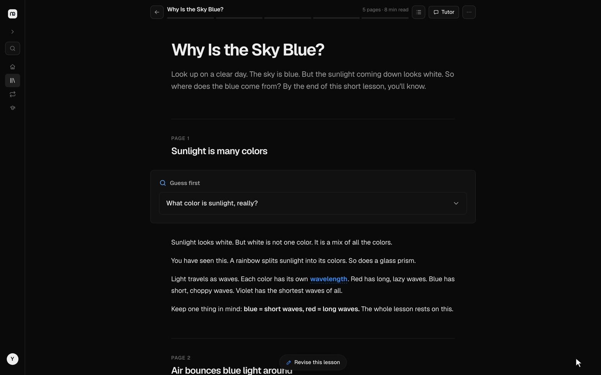
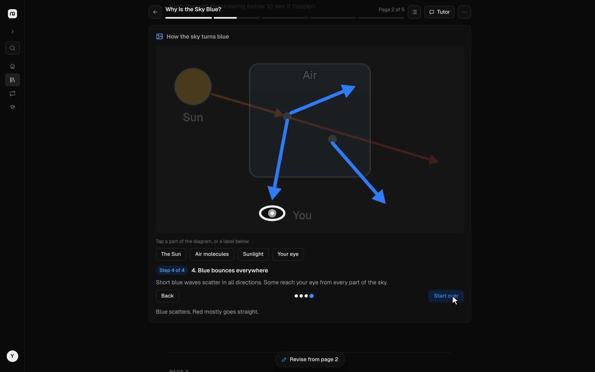
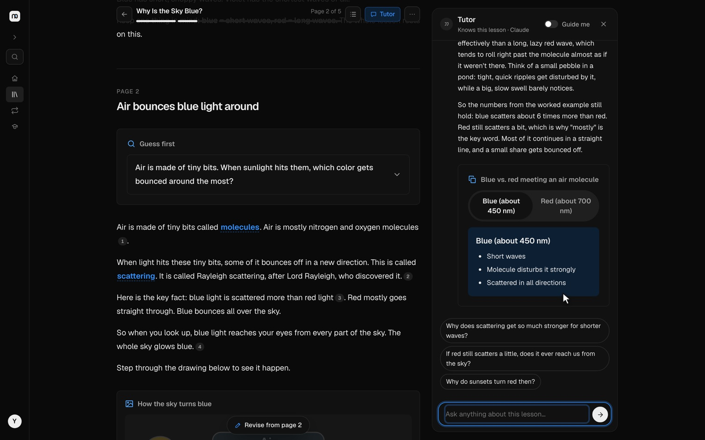
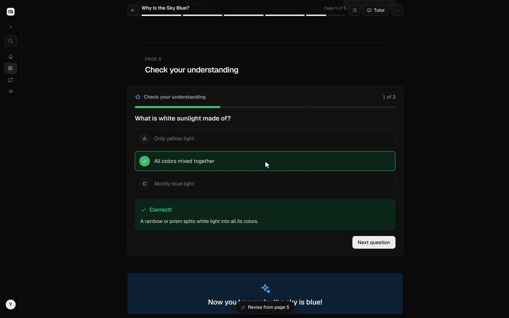

<p align="center">
  
</p>

<h1 align="center">
  &nbsp;Mull
</h1>

<p align="center">
  <b>Ask about anything. Get a short lesson you can touch.</b><br>
  Claude writes every lesson as live, interactive UI: diagrams you step through, guesses before answers, quizzes, and a tutor that knows the page you are on.
</p>

<p align="center">
  <a href="https://mull-learn.vercel.app"></a>
  &nbsp;
  <a href="https://www.producthunt.com/products/mull/launches/mull-2"></a>
</p>

<p align="center">
  
  
  
  
  
</p>

<br>

<p align="center">
  
</p>

## What Mull is

Mull is a learning app. You type a topic, and a few seconds later you are reading a short, paged lesson about it. The lesson is not a wall of text. Claude writes the interface too, so each page can hold a widget that fits the idea: a diagram to step through, a slider, flashcards, a timeline, a quiz.

When you finish a lesson, its key ideas become review cards. Mull schedules those cards with spaced repetition (the FSRS algorithm), so you see each one again just before you would forget it. A Teacher agent plans what to study next, and a learner memory lets every lesson and tutor reply build on what you already know.

<table>
  <tr>
    <td width="50%" valign="top">
      
      <p><b>Diagrams you step through.</b> Claude draws the idea and splits it into steps. Tap a part to read what it does.</p>
    </td>
    <td width="50%" valign="top">
      
      <p><b>A tutor that knows the lesson.</b> Ask anything. Answers can hold widgets too. Turn on <i>Guide me</i> for Socratic hints instead of answers.</p>
    </td>
  </tr>
  <tr>
    <td width="50%" valign="top">
      
      <p><b>Checks that are checked.</b> A second Claude pass reviews each lesson and fixes wrong answer keys before you see them.</p>
    </td>
    <td width="50%" valign="top">
      <h3>Also inside</h3>
      <ul>
        <li><b>Guess first:</b> each page asks you to predict before it explains.</li>
        <li><b>Your own material:</b> turn a PDF or notes into a lesson.</li>
        <li><b>Real sources:</b> lessons can cite the web, show Wikimedia images and play short video clips.</li>
        <li><b>Math:</b> formulas typeset with KaTeX, and interactive function graphs.</li>
        <li><b>Steer mid-lesson:</b> revise a lesson from any page while it streams.</li>
        <li><b>Streaks and XP:</b> a daily streak and reminders keep you coming back.</li>
      </ul>
    </td>
  </tr>
</table>

## How it works

Mull joins two ideas that this repository first took apart from shipped web clients:

- **ChatGPT's generative UI.** The model writes JSX-like tags inside its markdown. The server compiles the growing message into a small UI program on every revision and streams it to the browser. The browser runs the program in a sandboxed Web Worker and applies the result to the page.
- **wondering.app's learning loop.** Short paged lessons, a tutor, review cards and spaced repetition.

```text
  Claude  ──text──▶  compiler  ──UI program──▶  NDJSON stream  ──▶  sandboxed worker  ──▶  page
  (writes markdown     (validates widget props,      (every ~150 ms or        (runs the program,     (lesson,
   with UI tags)        falls back to plain text)     when a tag closes)       emits render ops)      widgets)
```

Three Claude models share the work: `claude-opus-5-5` writes lessons, `claude-sonnet-5-5` runs the tutor and the Teacher, and `claude-haiku-5-5` pulls out review cards and memories after each lesson. Lesson quality is measured with an eval harness (`npm run eval`).

## Run it locally

```bash
cd genui-lab/wonder
npm install
echo "ANTHROPIC_API_KEY=sk-ant-..." > .env
npm run dev
```

Then open <http://localhost:8750>. Without a Claude key the app still starts, but lessons, the tutor and the Teacher answer `503`.

Accounts, sync, daily limits and the Pro plan are off until you set Neon Auth, a database and Polar billing. The [app README](genui-lab/wonder/README.md) covers every setting, endpoint and design decision.

To run the tests:

```bash
npm --prefix genui-lab/wonder test
```

## The research behind it

Mull started as a reverse-engineering study of two "intelligent UI" systems. The findings and working rebuilds are still here.

| Path | What it holds |
|---|---|
| [`re/chatgpt-findings.md`](re/chatgpt-findings.md) | ChatGPT's web client: the DIL generative-UI runtime, the conversation-source NDJSON stream, the Skybridge widget host and the Octane/StyleX stack. |
| [`re/wondering-findings.md`](re/wondering-findings.md) | wondering.app: `{{interactive:…}}` lesson widgets, the chat and Teacher SSE streams, the realtime voice tutor, FSRS practice and the Supabase backend. |
| [`genui-lab/chatgpt-dil/`](genui-lab/chatgpt-dil) | A rebuild of the DIL compiler, the sandboxed worker runtime, the DOM host and stream replay. |
| [`genui-lab/wondering-genui/`](genui-lab/wondering-genui) | A rebuild of the interactive-marker parser, component registry, SSE reducers and FSRS. |
| [`genui-lab/wonder/`](genui-lab/wonder) | Mull itself. |

To view the two rebuilds and run their tests:

```bash
python3 -m http.server 8740 --directory genui-lab
```

```bash
node --test genui-lab/chatgpt-dil/test/index.js genui-lab/wondering-genui/test/*.test.js
```

<details>
<summary><b>How the evidence was handled</b></summary>
<br>

The analysis was static and used public JavaScript bundles. Live capture was limited to three logged-out ChatGPT test prompts. Session tokens (conduit, resume, stop, sentinel, proof, turnstile) are redacted in every committed file. Raw captures and copied third-party bundles are excluded by `.gitignore`.

</details>

<br>

<p align="center">
  <sub>Built with Claude · <a href="https://mull-learn.vercel.app">mull-learn.vercel.app</a> · <a href="https://www.producthunt.com/products/mull/launches/mull-2">Mull on Product Hunt</a></sub>
</p>
